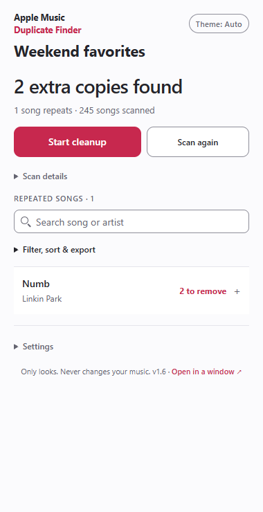

<div align="center">


# Apple Music Duplicate Finder

Find the songs that show up more than once in your Apple Music playlists.

[**Download v1.5**](https://github.com/awishtodiexz/Apple-Music-duplicate-finder/releases/download/v1.5.1/apple-music-duplicate-finder-v1.5.1.zip) · [Install](#install) · [Privacy](#privacy)

[](https://github.com/awishtodiexz/Apple-Music-duplicate-finder/actions/workflows/ci.yml)
[](LICENSE)

<picture>
  <source media="(prefers-color-scheme: dark)" srcset="docs/images/screenshot-dark.png">
  
</picture>

</div>

## Features

- **Exact matches.** Songs are matched by their Apple Music ID, not by title, so different versions of a song stay separate.
- **Positions.** See every spot in the playlist where a song appears.
- **Search, sort and export.** Filter the list, copy it, or save it as CSV.
- **Read-only.** It never edits, reorders or deletes anything. You decide what to remove.
- **Remembers your last scan** and tells you when the playlist has changed since then.
- **Light and dark themes**, keyboard support, and a toolbar badge with the duplicate count.

## Install

Works in Chrome and Edge 111 or newer. It isn't on the Chrome Web Store, so you load it manually:

1. [Download the ZIP](https://github.com/awishtodiexz/Apple-Music-duplicate-finder/releases/download/v1.5.1/apple-music-duplicate-finder-v1.5.1.zip) and extract it to a folder you'll keep.
2. Go to `chrome://extensions` (or `edge://extensions`) and turn on **Developer mode**.
3. Click **Load unpacked** and pick the extracted folder.

To update, extract the new ZIP over the same folder and click **Reload** on the extensions page.

> [!NOTE]
> Download `apple-music-duplicate-finder-v1.5.1.zip` from the release, not GitHub's *Source code* archive, which needs to be built first. Each release also has a `.zip.sha256` checksum if you want to [verify it](docs/DEVELOPMENT.md#verify-a-download).

## Usage

1. Open a playlist on [music.apple.com](https://music.apple.com) while signed in.
2. Click the extension icon and press **Scan for duplicates**.
3. Keep the popup open until it finishes. Clicking outside closes it, so use **Open in a window** for long playlists.

A result like *"2 copies · 1 extra"* with positions *"#12 keep · #84"* means the song appears at positions 12 and 84. Remove the extra copy in Apple Music, then scan again.

Scans stop after a ten-minute limit or 50,000 songs, and a failed scan never shows partial results.

### Troubleshooting

| Message | What to do |
| --- | --- |
| Open a playlist | Go to a playlist on music.apple.com and reopen the popup. |
| The Apple Music player hasn't finished loading | Wait for the player to load, then press Retry connection. |
| Sign in to Apple Music in this tab | Your Apple Music session expired. Sign in again, then press Retry connection. |

## Privacy

Everything runs in your browser. The extension talks only to Apple Music, using the session already open in your tab. No accounts, no analytics, no servers. It asks for just two permissions, `activeTab` and `scripting`, and the last scan is stored locally until you press **Clear results**.

Curious how it works? See [ARCHITECTURE.md](docs/ARCHITECTURE.md).

## Development

```sh
npm ci
npx playwright install chromium
npm run check
```

This builds the extension into `dist/` and runs the full test suite. See [DEVELOPMENT.md](docs/DEVELOPMENT.md) for more.

## Contributing

Bug reports and pull requests are welcome. Please read the [contributing guide](.github/CONTRIBUTING.md) first, and report security issues [privately](.github/SECURITY.md).

## License

[MIT](LICENSE). Not affiliated with Apple. Apple Music is a trademark of Apple Inc.
