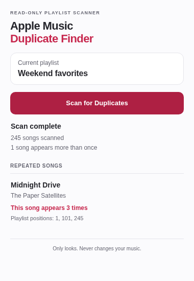

<p align="center">
  
</p>

<h1 align="center">Apple Music Duplicate Finder</h1>

<p align="center">Find repeated songs in your Apple Music playlists.</p>

<p align="center">
  <a href="https://github.com/awishtodiexz/Apple-Music-duplicate-finder/releases/download/v1.0/apple-music-duplicate-finder-1.0.zip"><strong>Download 1.0</strong></a>
  · <a href="#installation">Installation</a>
  · <a href="#privacy">Privacy</a>
</p>

A free Chrome and Edge extension that shows which songs appear more than once, and where to find them. It only reads your playlist; it never changes your music.

<p align="center">
  
  <br><sub>Actual extension interface with fictional demo data.</sub>
</p>

## Installation

1. [Download the extension ZIP](https://github.com/awishtodiexz/Apple-Music-duplicate-finder/releases/download/v1.0/apple-music-duplicate-finder-1.0.zip) and extract it into a folder you intend to keep.
2. Open `chrome://extensions` in Chrome or `edge://extensions` in Edge.
3. Enable **Developer mode**, then choose **Load unpacked**.
4. Select the extracted folder containing `manifest.json`.
5. Pin the extension to your toolbar for easy access.

No development tools are needed. On the [release page](../../releases/latest), choose `apple-music-duplicate-finder-1.0.zip`; GitHub's *Source code* archives require building first. Some managed browsers block unpacked extensions.

**To update:** extract the latest extension ZIP over the same folder, then click **Reload** on the Extensions page. Updates are manual.

## Scan a playlist

1. Sign in at [music.apple.com](https://music.apple.com) and open a playlist.
2. Open the extension and check the **Current playlist** name.
3. Click **Scan for Duplicates** and keep the popup open until it finishes.

**“This song appears twice”** at **positions 12 and 84** means it is listed at number 12 and again at number 84. You can review those entries in Apple Music and remove unwanted ones yourself. Rescan after changing the playlist.

## What it matches

Songs are matched by Apple Music identifiers, not titles. Different editions may stay separate, and entries without reliable identifiers are excluded. The popup explains when Apple hasn't supplied a total to verify the count. If a request fails or the reader detects missing data, it shows an error.

Avoid editing the playlist during a scan. Closing the popup discards its results.

A successful 1,200-song scan has been reported in Chrome. Edge and other account configurations still need independent live testing. Apple can change its web player, so compatibility may change too. See [testing and limitations](docs/TESTING.md).

## Privacy

- Playlist data is processed in browser memory and is not stored by the extension.
- No passwords, cookies or authentication tokens are collected.
- No analytics, backend, or third-party uploads.
- Only `activeTab` and `scripting` permissions are requested.

The extension uses your existing Apple Music session. There is no separate extension account. [How it works](docs/ARCHITECTURE.md).

## Build from source

Requires Node.js 22.8+ and npm. Browser tests also need an installed Chromium executable; see [development instructions](docs/DEVELOPMENT.md).

```sh
npm ci
npm run check
npm run package
```

Load `dist/` as an unpacked extension. The installation ZIP is generated in `artifacts/`.

## Help and contributions

[Report a bug](../../issues) with your browser version and steps to reproduce it. Redact account details and private playlist information. For vulnerabilities, follow the [security policy](SECURITY.md).

[Contributing](CONTRIBUTING.md) · [Changelog](CHANGELOG.md) · [MIT license](LICENSE)

<sub>Independent project. Not affiliated with or endorsed by Apple Inc. Apple Music is a trademark of Apple Inc.</sub>
