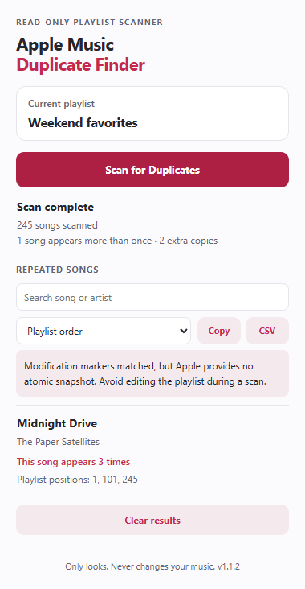

<p align="center">
  
</p>

<h1 align="center">Apple Music Duplicate Finder</h1>

<p align="center">Find repeated songs in your Apple Music playlists.</p>

<p align="center">
  <a href="https://github.com/awishtodiexz/Apple-Music-duplicate-finder/releases/download/v1.1.1/apple-music-duplicate-finder-v1.1.1.zip"><strong>Download v1.1.1</strong></a>
  · <a href="#installation">Installation</a>
  · <a href="#privacy">Privacy</a>
</p>

<p align="center">
  <a href="https://github.com/awishtodiexz/Apple-Music-duplicate-finder/actions/workflows/ci.yml"></a>
</p>

A free, open-source Chrome and Edge extension that shows which songs appear more than once, and where to find them. It only reads your playlist; it never changes your music.

<p align="center">
  
  <br><sub>Actual extension interface with fictional demo data. The consistency note explains that matching modification markers are not an atomic snapshot.</sub>
</p>

## What it does

- Finds entries that share an Apple Music song identifier, not just a title.
- Shows every playlist position where each repeated song appears.
- Read-only; it never edits, reorders, or deletes music.
- Lets you cancel scans and enforces five-minute, 50,000-entry, 2,000-page, and 16-million-character limits.
- Renders results in batches with keyboard focus and light/dark theme support.

## Installation

Requires Chrome or Edge 111 or newer on desktop. This is a manual unpacked extension; it is not published on the Chrome Web Store.

1. [Download the v1.1.1 ZIP](https://github.com/awishtodiexz/Apple-Music-duplicate-finder/releases/download/v1.1.1/apple-music-duplicate-finder-v1.1.1.zip) and extract it into a folder you intend to keep.
2. Open `chrome://extensions` in Chrome or `edge://extensions` in Edge.
3. Enable **Developer mode**, then choose **Load unpacked**.
4. Select the extracted folder containing `manifest.json`.
5. Pin the extension to your toolbar for easy access.

No development tools are needed. On the [release page](../../releases/latest), choose `apple-music-duplicate-finder-v1.1.1.zip`; GitHub's *Source code* archives require building first. The release also includes a `.sha256` checksum; see [release verification](docs/RELEASING.md#verify-a-download). Some managed browsers block unpacked extensions.

**To update:** extract the latest extension ZIP over the same folder, then click **Reload** on the Extensions page. Updates are manual.

## Scan a playlist

1. Sign in at [music.apple.com](https://music.apple.com) and open a playlist.
2. Open the extension and check the **Current playlist** name.
3. Click **Scan for Duplicates** and keep the popup open until it finishes.

Use **Cancel scan** to stop and start again. Cancelled, timed-out, failed, or resource-limited scans discard their results. Scans are limited to five minutes, 50,000 entries, 2,000 pages, and 16 million metadata characters.

**“This song appears twice”** at **positions 12 and 84** means it is listed at number 12 and again at number 84. You can review those entries in Apple Music and remove unwanted ones yourself. Rescan after changing the playlist.

## Troubleshooting

- **“Open a playlist”** — navigate to a playlist on `music.apple.com`, then reopen the extension.
- **“MusicKit unavailable”** — let the player finish loading, reload the page, and retry.
- **“Sign in”** — your Apple Music session may have expired; sign in again in the tab.
- **The popup closed** — clicking outside the toolbar popup discards the scan. Keep it focused until scanning finishes.
- **“No total supplied”** — Apple did not provide an independent count; the popup explains that all pages were read but the count is unverified.

## What it matches

Songs are matched by Apple Music identifiers, not titles. Different editions may stay separate, and entries without reliable identifiers are excluded. The popup explains when Apple hasn't supplied a total to verify the count. If a request fails or the reader detects missing data, it shows an error.

Avoid editing the playlist during a scan. This is a browser toolbar popup: clicking outside it closes it and discards the scan. Keep it focused until scanning finishes; the toolbar popup intentionally retains this behavior.

The popup reports whether modification markers were available. Matching counts or markers cannot prove an atomic snapshot; same-count edits and reordering can escape detection. Rescan after editing.

Live-tested on Chrome with a roughly 1,200-song playlist in October 2026: the scan completed, found duplicates, and showed no visible issues. Edge and other account configurations still need independent live testing. Apple can change its web player, so compatibility may change too. See [testing and limitations](docs/TESTING.md).

## Privacy

- Playlist data is processed in browser memory and is not stored by the extension.
- No passwords, cookies or authentication tokens are collected.
- No analytics, backend, or third-party uploads.
- Only `activeTab` and `scripting` permissions are requested.

The only network requests are read-only Apple Music API calls made through the open page's existing session. There is no separate extension account. [How it works](docs/ARCHITECTURE.md).

## Build from source

Supports Node.js 22 (22.8+), 24, and 26 with npm; use a current patched release. Browser tests use Playwright's pinned Chromium; see [development instructions](docs/DEVELOPMENT.md).

```sh
npm ci
npx --no-install playwright install chromium
npm run check
npm run audit
```

Load `dist/` as an unpacked extension. The checks generate `artifacts/apple-music-duplicate-finder-v1.1.1.zip` and its `.zip.sha256` checksum. Download both files from the release if you want to verify the installation ZIP; see [release verification](docs/RELEASING.md#verify-a-download).

`npm run check` includes type checks, unit tests, browser fixtures, an installed-extension smoke test, deterministic ZIP/checksum checks, and static security checks. These controlled tests do not establish full compatibility with the live Apple Music service.

## Help and contributions

[Report a bug](../../issues) with your browser version and steps to reproduce it. Redact account details and private playlist information. For vulnerabilities, follow the [security policy](.github/SECURITY.md).

[Contributing](.github/CONTRIBUTING.md) · [Changelog](CHANGELOG.md) · [MIT license](LICENSE)

<sub>Independent project. Not affiliated with or endorsed by Apple Inc. Apple Music is a trademark of Apple Inc.</sub>
